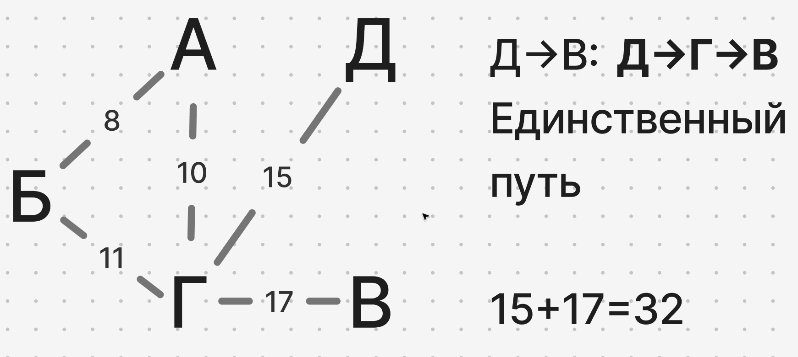
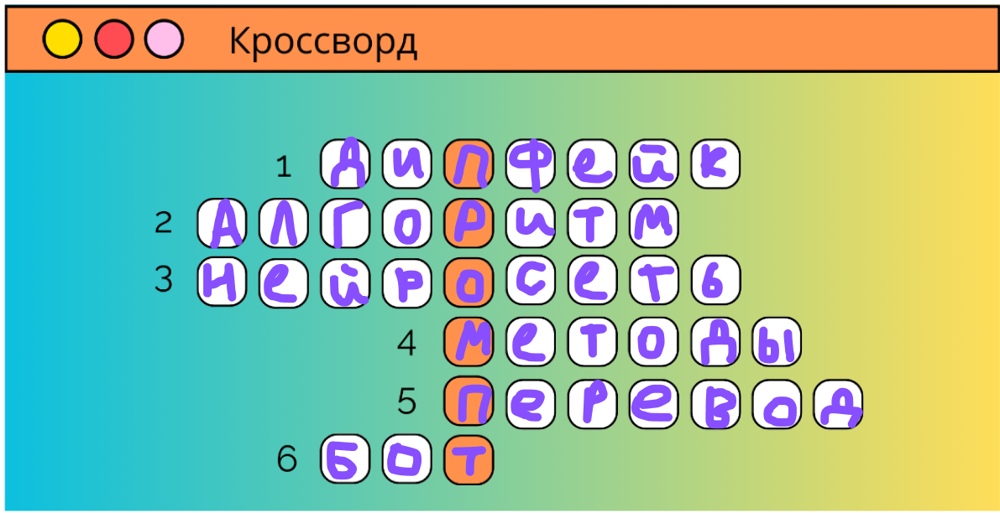
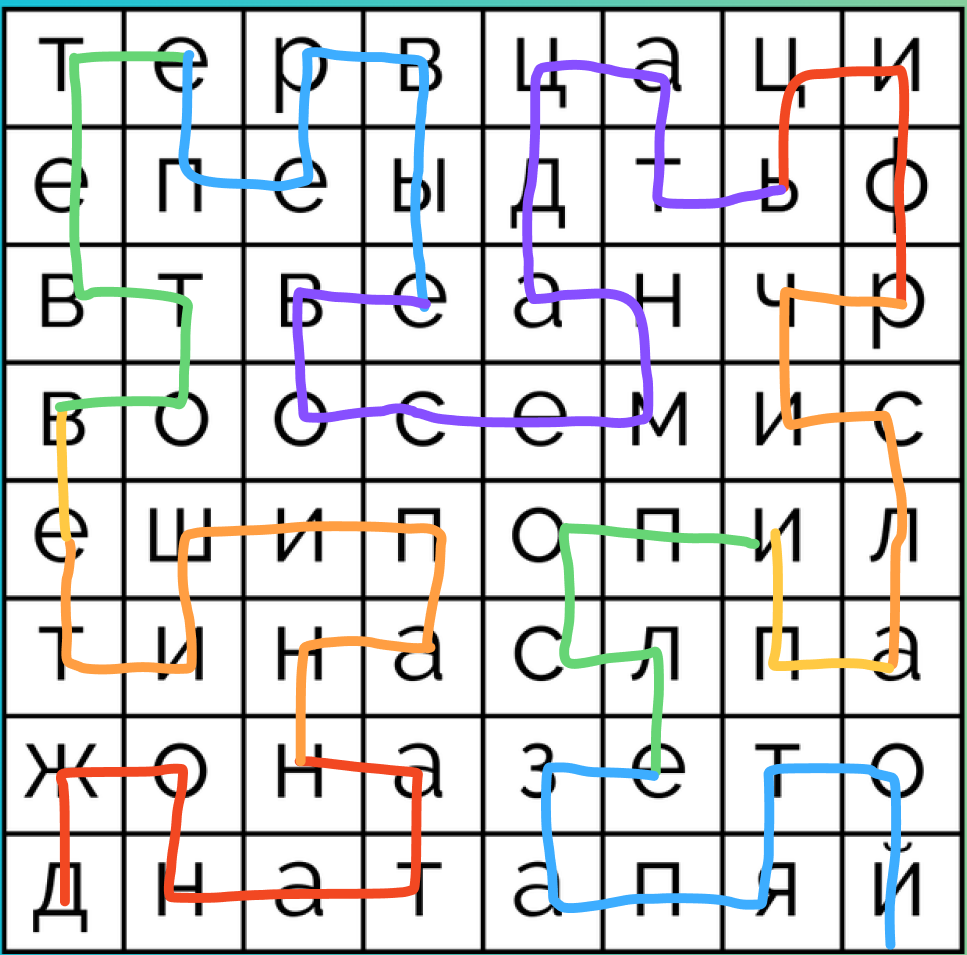

# Решение задач на логику

## Слайд 3
x — время от начала суток
(24 - x) — время до конца суток
По условию:
x = (1/5) * (24 - x)

5x = 24-x
6x = 24 
x = 4

**Ответ: 4**

## Слайд 4
Чётные можно разбить на пары (-1 + 2), (-3 + 4) и т.д. Каждая такая пара в сумме дает +1
А в нечётных, последнее число останется без пары

Код из файла ./code_task_1.py
```python
import sys

try:
    a = int(input("Введите первое число> "))
    b = int(input("Введите второе число> "))
except ValueError:
    print(
        "\n\033[31mОба числа должны быть целыми!\nПопробуйте ещё раз. \033[0m",
        file=sys.stderr,
    )
    sys.exit(1)


if b % 2 == 0:
    sum_before_b = b // 2
else:
    sum_before_b = -(b + 1) // 2

# Т.к. от А включительно, то исключаем его из того что будет вычитать
temp = a - 1

if temp % 2 == 0:
    sum_before_a = temp // 2
else:
    sum_before_a = -(temp + 1) // 2

result = sum_before_b - sum_before_a

print(result)
```

## Слайд 5
Построил граф в Figma

Что бы попасть Д->В, это Д->Г->В — Единственный путь
15+17=32

**Ответ: 32**

## Слайд 6
Без циклов надо подумать...
Условие:
- В алфавите 3 символа X, Y, Z
- Слово из 5 букв
- Последовательность идёт в алфавитном порядке

*в алфавитном порядке*, для компьютера строчка это просто числа и X<Y<Z
Представим строчки как числа в троичной системе X=0, Y=1, Z=2

1. 00000
2. 00001
3. 00002
4. 00010
...
На каждом шаге мы прибавляем 1
5. 00011
...

Правда таблица смещена, под номером 1 будет 0 в троичной, а значит под номером 179 будет 178 в троичной
178 в троичной -> 20121 
20121 буквами -> ZXYZY 

**Ответ: ZXYZY**

## Слайд 7


**Ответ: ПРОМПТ**

## Слайд 8
`n // k` находит, сколько чисел в диапазоне от 1 до `n` нацело делятся на `k`.
Код из файла ./code_task_2.py
```python
import sys

try:
    n = int(input("Введите второе число> "))
except ValueError:
    print(
        "\n\033[31mЧисло должно быть целым!\nПопробуйте ещё раз. \033[0m",
        file=sys.stderr,
    )
    sys.exit(1)

# Количество чисел от 1 до n, которые делятся на k
div2 = n // 2
div3 = n // 3
div5 = n // 5

div2_3 = n // 6
div2_5 = n // 10
div3_5 = n // 15

div2_3_5 = n // 30

result = n - (div2 + div3 + div5) + (div2_3 + div2_5 + div3_5) - div2_3_5

print(
    f"Количество целых положительных чисел, не превосходящих n, которые не делятся ни на одно из чисел 2,3 и 5 - {result}"
)
```

## Слайд 9


**Ответ: 3.141592653589793238**

## Слайд 10
Кеша -> к=х -> Хеша' -> Хеш \
'Мир -> ир \
Овал' -> ова \
Н и Е -> ние \

**Ответ: Хеширование**
